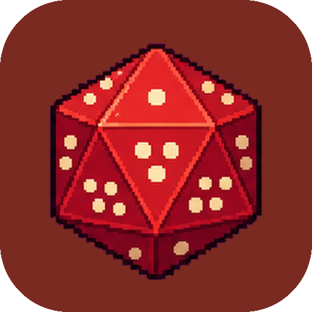
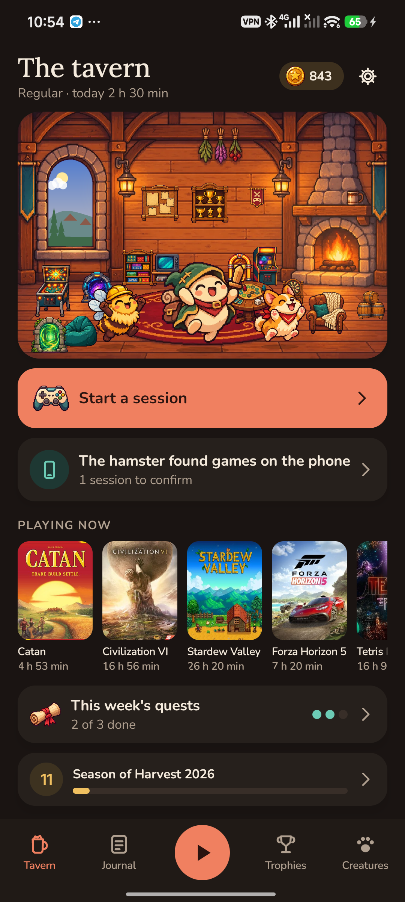
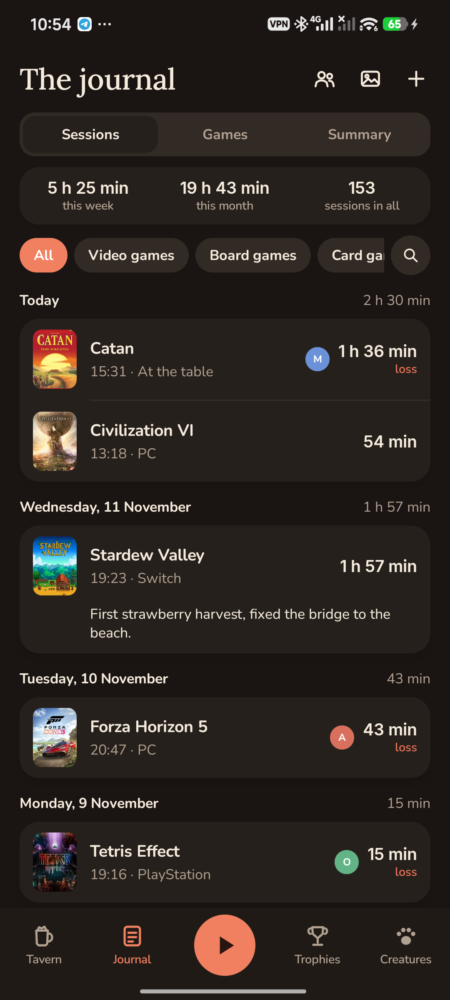
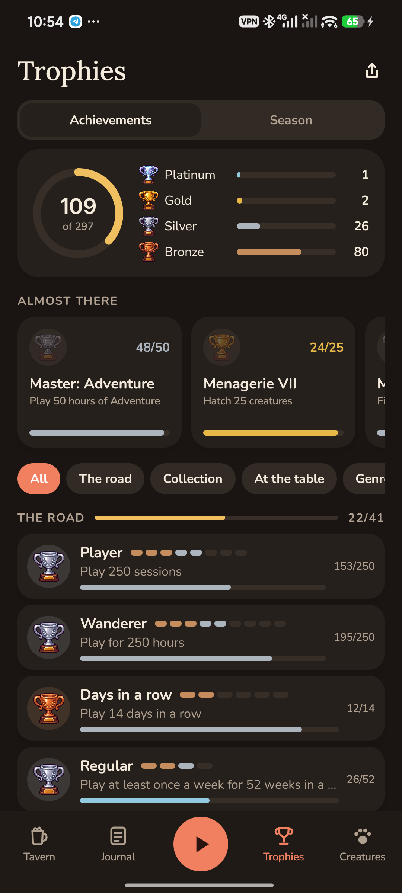
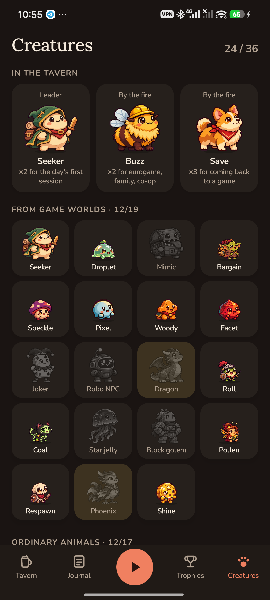

<p align="center"></p>

<h1 align="center">Questling</h1>

<p align="center">A diary of everything you play – video games, board games, anything – with creatures that grow on it.<br>
<a href="https://bigdevwhale.github.io/stillcraft/apps/questling/">Website</a> · <a href="https://github.com/bigdevwhale/questling/releases/latest/download/Questling.apk">Download APK</a> · <a href="README.ru.md">Русский</a></p>

You keep a small tavern at the crossroads of worlds, «The Last Save». Creatures live by its hearth: some came out of game worlds – a slime, a mimic, a goblin merchant, a living d20 – others are ordinary animals with a gamepad in their paws. Every session you play feeds them, and at night what they ate turns into growth. The way you play decides who comes next.

<p align="center">




</p>

## What's inside

- **Any game.** Video games on any platform, board games, card games, tabletop RPG campaigns, phone games. Type a title and the catalogue (Wikidata and Wikipedia) fills in the cover, the year, the maker and the genres – or fill it in by hand.
- **Sessions.** Press the big button and the clock runs, in the background too. Or write down a session already played. At the end: how it ended, the score, a moment (a boss, a chapter, the credits, 100%), the mood, a note.
- **Screenshots by themselves.** Screenshots the phone made during a session are offered when you finish it; add photos of the table from the gallery or the phone's own camera. Everything gathers in the album.
- **Phone games found for you.** With usage access turned on, the phone tells which games you played and for how long; each stretch becomes a session with one tap.
- **Table tools.** Dice from d4 to d100, a fair «who goes first», a turn timer and a score sheet that knows who won.
- **Players.** The people you play with: hours together, the score between you, your game together.
- **36 creatures**, found by the way you play: the slime for RPG hours, the meeple for board game nights, the necro cat for late sessions, the corgi for coming back to an old game. Six stats each, a class and a favourite genre from the games they grew on. Three live by the fire and double the gold for their thing.
- **Nearly 300 trophies** in bronze, silver, gold and platinum – ladders for sessions, hours, games, genres, wins and company, and dozens of secret ones.
- **Weekly quests and a season pass.** Three quests every Monday; a season is a quarter with thirty levels of rewards. Nothing can be bought with money.
- **The summary.** Hours by week, month, season and year, a calendar, top games, genres, platforms, wins and losses, weekdays and hours of the day, the player's shape as a six-rayed star, and the year in games. Nine kinds of share cards.
- **Rest pays.** After a while without a break your pet yawns and suggests a stretch – once, without nagging. Breaks bring gold, and the hours past three a day feed the creatures less. Nobody starves, nothing is lost.

## Privacy

No account, no analytics, no ads. Everything stays on the phone. See [PRIVACY.md](PRIVACY.md).

## Building

```
./gradlew assembleDebug              # app.questling.dev
./gradlew assembleDebug -Pdemo       # app.questling.demo with half a year of play
./gradlew testDebugUnitTest -Prender --tests '*RenderScreens*'   # every screen to app/build/art/screens
```

The art is generated: `python tools/gen_art.py` (Codex CLI image tool) draws the sheets into `art/sheets`, `python tools/cut.py` cuts them into drawables, `python tools/icon.py` makes the launcher icon.

Questling is one of the small [StillCraft](https://bigdevwhale.github.io/stillcraft/) apps. MIT licence.
