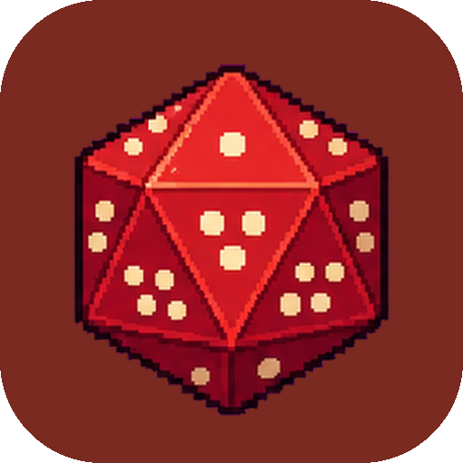
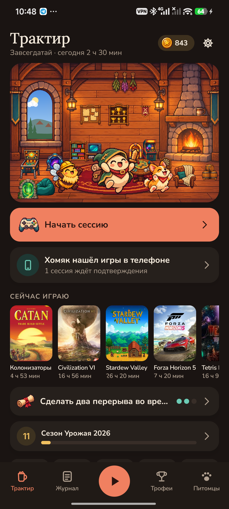
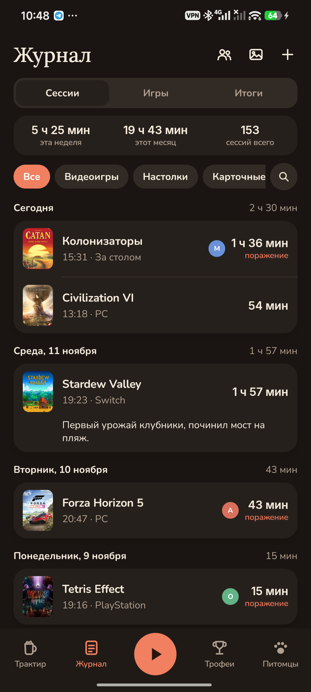
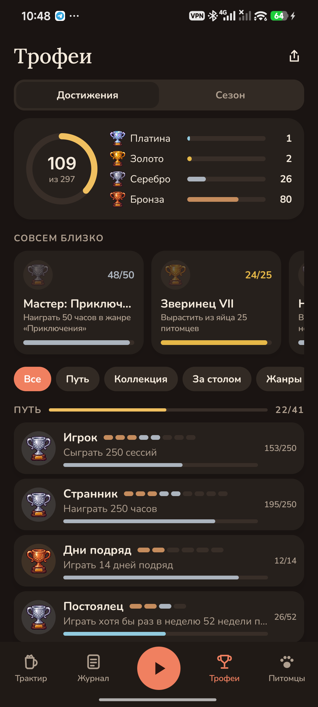
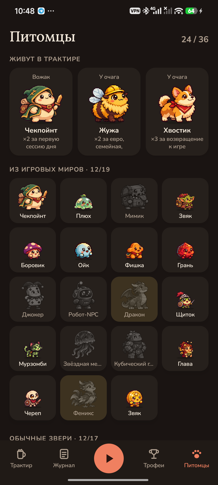

<p align="center"></p>

<h1 align="center">Questling</h1>

<p align="center">Дневник всего, во что вы играете – видеоигры, настолки, что угодно, – и питомцы, которые от этого растут.<br>
<a href="https://bigdevwhale.github.io/stillcraft/apps/questling/">Сайт</a> · <a href="https://github.com/bigdevwhale/questling/releases/latest/download/Questling.apk">Скачать APK</a> · <a href="README.md">English</a></p>

Вы держите небольшой трактир на перекрёстке миров – «Последнее сохранение». У очага живут питомцы: одни пришли из игровых миров – слайм, мимик, гоблин-торговец, живой двадцатигранник, – другие обычные звери с геймпадом в лапах. Каждая сессия их кормит, а ночью съеденное превращается в рост. От того, как вы играете, зависит, кто придёт следующим.

<p align="center">




</p>

## Что внутри

- **Любая игра.** Видеоигры на любой платформе, настолки, карточные игры, ролевые кампании, игры на телефоне. Введите название – каталог (Wikidata и Википедия) подставит обложку, год, автора и жанры. Или заполните сами.
- **Сессии.** Нажмите большую кнопку – пойдёт время, в том числе в фоне. Или запишите сессию, которую уже сыграли. В конце: чем закончилось, очки, важный момент (босс, глава, титры, 100%), настроение, заметка.
- **Скриншоты сами.** Снимки экрана, сделанные за время сессии, приложение предложит, когда вы её закончите. Фото стола можно добавить из галереи или снять камерой телефона. Всё собирается в альбоме.
- **Игры на телефоне находятся сами.** Если разрешить доступ к статистике использования, телефон подскажет, во что и сколько вы играли. Каждый отрезок становится сессией в одно нажатие.
- **Инструменты для настолок.** Кубики от d4 до d100, честный выбор первого игрока, таймер хода и протокол очков, который сам знает, кто победил.
- **Игроки.** Те, с кем вы играете: часы вместе, счёт между вами, любимая игра на двоих.
- **36 питомцев.** Они находятся за то, как вы играете: слайм – за часы в RPG, мипл – за настольные вечера, некрокот – за поздние сессии, корги – за возвращение к старой игре. У каждого шесть характеристик, класс и любимый жанр – по играм, на которых он вырос. Трое живут у очага и удваивают золото за своё дело.
- **Почти 300 трофеев** – бронза, серебро, золото и платина. Лестницы за сессии, часы, игры, жанры, победы и компанию, плюс десятки секретных.
- **Задания недели и сезон.** Три задания каждый понедельник. Сезон – это квартал и тридцать уровней наград. За деньги ничего купить нельзя.
- **Итоги.** Часы за неделю, месяц, сезон и год, календарь, главные игры, жанры, платформы, победы и поражения, дни недели и время суток, профиль игрока шестилучевой звездой и «Год в играх». Девять видов карточек, которыми можно поделиться.
- **Отдыхать выгодно.** Если долго играть без перерыва, питомец зевнёт и позовёт размяться – один раз, без уговоров. За перерывы дают золото, а часы сверх трёх в день кормят питомцев слабее. Никто не голодает, ничего не сгорает.

## Приватность

Без аккаунта, аналитики и рекламы. Всё хранится на телефоне. Подробнее – в [PRIVACY.md](PRIVACY.md).

## Сборка

```
./gradlew assembleDebug              # app.questling.dev
./gradlew assembleDebug -Pdemo       # app.questling.demo с полугодом игры
./gradlew testDebugUnitTest -Prender --tests '*RenderScreens*'   # все экраны в app/build/art/screens
```

Арт сгенерирован: `python tools/gen_art.py` (инструмент изображений Codex CLI) рисует листы в `art/sheets`, `python tools/cut.py` режет их на картинки, `python tools/icon.py` делает иконку.

Questling – одно из небольших приложений [StillCraft](https://bigdevwhale.github.io/stillcraft/). Лицензия MIT.
